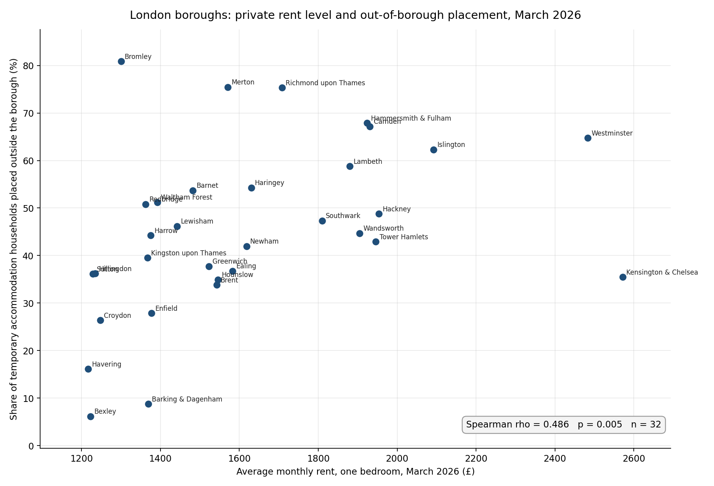

# Rent levels and out-of-borough placement in London, March 2026



## The question

**Do London boroughs with higher private rents place a larger share of
their temporary accommodation households outside the borough?**

Housing in London 2026 reports 76,040 households in temporary
accommodation at the end of March 2026, the highest since the series
began in 1988, and 35,460 of them placed outside their home borough. A
household placed outside its borough is a household moved away from its
school, its GP and often its work. This asks whether rent level is what
is pushing them out.

The question, and the three conditions that would falsify the answer,
were written down before the data was opened.

## The datasets

**MHCLG, Statutory homelessness in England, January to March 2026**,
detailed local authority level tables. Published 13 August 2026.
Table **TA1** for total households in temporary accommodation, table
**TA9_TATYPE** for households placed in temporary accommodation in
another local authority.
https://www.gov.uk/government/statistics/statutory-homelessness-in-england-january-to-march-2026

**ONS, Price Index of Private Rents, UK: monthly price statistics**,
21 October 2026 edition. Average monthly one-bedroom rent, March 2026.
https://www.ons.gov.uk/economy/inflationandpriceindices/datasets/priceindexofprivaterentsukmonthlypricestatistics

Joined on ONS local authority code, E09000001 to E09000033, rather than
on borough name, so that spelling differences could not silently drop a
row. The City of London is excluded because ONS does not publish rent
figures for it. 32 rows.

## The finding

**Spearman rho = 0.486, p = 0.005, n = 32.**

Positive, unlikely to be chance, and modest. Roughly 24 per cent of
shared rank variance, so rent is one input among several rather than the
mechanism.

It survived all three falsification tests:

| Test | Result |
|---|---|
| Correlation near zero or negative? | No. rho = 0.486, p = 0.005 |
| Driven by the most expensive boroughs? | No. Dropping the top three *strengthens* it to rho = 0.527, p = 0.003, n = 29 |
| Does demand explain it better than rent? | No. TA per 1,000 households gives rho = 0.100, p = 0.59 |

The third is the strongest result here. Newham has the largest caseload
in London at 7,561 households and a middling 42 per cent placed out.
Pressure of demand does not predict who gets sent away.

**Where it breaks.** Bromley is the sixth cheapest borough at £1,300 for
a one-bed and places 81 per cent of its households out, the highest
share of all 32. Kensington and Chelsea is the most expensive by a
distance, and 24 of the 32 boroughs place a larger share out than it
does. Borough stock and placement policy are doing work that rent level
does not capture.

## One limitation

This is a correlation across 32 boroughs at a single point in time. It
cannot distinguish a borough that places families out because rents are
high from one that places them out because it holds no stock of its own,
and those two conditions travel together. Nothing here establishes a
causal push.

(Further limitations, including the four and a half month lag in the
homelessness data and ONS treating local authority rents as
experimental, are in the full write-up.)

## Files

| File | What it is |
|---|---|
| `analysis.py` | The full pipeline. Reproducible from the two source files |
| `joined_32_boroughs.csv` | The joined dataset, 32 rows |
| `rent_vs_out_of_borough.png` | The scatter |
| `London_TA_Findings.docx` | Full write-up with method, recommendations and limitations |

## Reproducing this

Download both source files from the links above, update the two paths at
the top of `analysis.py`, then:

```
pip install pandas odfpy openpyxl matplotlib
python analysis.py
```

The source files are not committed here. They are published government
data and linking them is cleaner than republishing them.

## What next

TA9 records destination by region and TA9_HHTYPE splits out-of-area
placements by household composition. Isolating households with dependent
children and mapping origin against destination is the analysis that
actually bears on whether children keep their schools.

---

Caroline Itiola
